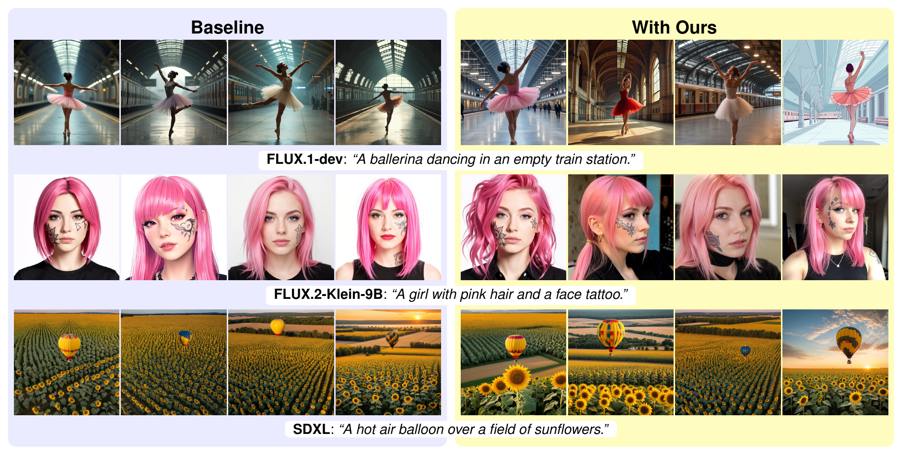
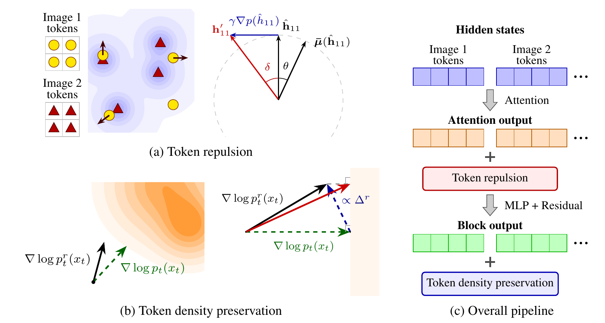

<h1 align="center">TokenRepel: Generating Diverse Image Sets Without Compromising Quality (NeurIPS2026)</h1>

<p align="center">
  Qingtao Yu &nbsp; Zhen Wang &nbsp; Ning Lai &nbsp; Boyang Hu &nbsp; Hongdong Li &nbsp; Dylan Campbell
  <br>
  The Australian National University
</p>

<p align="center"></p>

<p align="center"></p>

Illustration of our TokenRepel algorithm.
In (a) (left), the tokens of Image 1 are repelled by taking a negative gradient induced by the distribution formed from the tokens of the other images.
(a) (right) presents the detailed update formulation for $`\mathbf{h}_{11}`$,
where $`\bar{\mu}(\hat{\mathbf{h}}_{11})`$ denotes the weighted mean of the other image tokens with respect to their cosine similarity to $`\mathbf{h}_{11}`$.
In (b) (left), the contours represent the learned data distribution of the generative model.
The green dashed arrow indicates the original score, while the black solid arrow represents the score after applying token repulsion.
(b) (right) illustrates the refinement process applied to $`\nabla \log p^r_t(x_t)`$ to project it into the higher-density half-space.
(c) shows where these two operations are applied inside the transformer block.

## Installation

```bash
conda create -n tokenrepel python=3.11 -y
conda activate tokenrepel
pip install -r requirements.txt
```

## Usage

Supported models: FLUX.1-dev (`flux`), FLUX.2-klein-9B (`flux2k`) and SDXL (`sdxl`, the Juggernaut-XI-v11 checkpoint).

```bash
# TokenRepel with the paper settings on the example prompts
python generate.py --model flux2k --prompts assets/example_prompts.json
python generate.py --model flux   --prompts assets/example_prompts.json
python generate.py --model sdxl   --prompts assets/example_prompts.json
```

| Option | Meaning |
|---|---|
| `--model` | `flux`, `flux2k` or `sdxl` |
| `--prompts` | a `.json` list of prompts, or a single prompt |
| `--delta` | push angle δ in degrees (< 90): larger = more diverse |
| `--theta_bar` | angle threshold θ̄ in degrees: only token pairs closer than θ̄ are pushed |
| `--step_start`, `--step_end` | TokenRepel is applied on the denoising steps `[step_start, step_end)` |
| `--preservation` | token density preservation: `none`, `velocity` or `layer` |
| `--preserve_blocks` | number of blocks to do `layer` preservation (`-1` = all) |
| `--out_dir` | output folder |
| `--num_gpus` | the prompts are split over this many GPUs |
| `--num_images_per_prompt` | images per prompt |
| `--max_chunk` | max images per forward pass |
| `--seed` | seed of the initial noise |
| `--resolution` | image height and width |
| `--inference_steps` | denoising steps |
| `--guidance_scale` | Classifier-free guidance if appliable |
| `--baseline` | plain sampling without TokenRepel |
